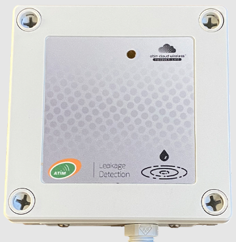

# ACW-WLL – Leak detector (former generation)



Water leak detection with a cable (CAB-WL, CAB-WLL with leak location, CAB-WLL-OIL for fuel oil) or with electrodes, with two optional temperature probes. The indoor WL-I version has a 100 dB buzzer; the outdoor WL-O version is IP66.

## Supported models

- ACW/LW8-WL-I, ACW/SF8-WL-I (indoor, with buzzer)
- ACW/LW8-WL-O, ACW/SF8-WL-O (outdoor, IP66)

The `voltage` field is measured on the cable or between the electrodes. With a cable it stays close to 0 when dry and rises when water is present; with electrodes it is the opposite. The alert threshold is set in the configurator (500 mV by default, i.e. 0.5 V in this codec).

The current leak detector, the ACW/MIO-WLK, is part of the MIO range: its codec is [ACW-MIO](../../io-modules/acw-mio).

## Documentation

| Model | Datasheet | User guide |
|---|---|---|
| ACW-WLL (WL-I, WL-O) | [PDF (FR)](https://atim.com/wp-content/uploads/documentation/ACW/ACW-WLL/FRANCAIS/ATIM_ACW-WLL_DS_FR.pdf) | [PDF (FR)](https://atim.com/wp-content/uploads/documentation/ACW/ACW-WLL/FRANCAIS/ATIM_ACW-WLL_UG_FR.pdf) |

Documents marked (FR) are only available in French.

## Codec

| File | Version | Entry points |
|---|---|---|
| [acw-wll-codec.js](acw-wll-codec.js) | 1.0.0 | `decodeUplink`, `encodeDownlink`, `decodeDownlink` |

The same file can be pasted as is into The Things Stack (TTN v3), ChirpStack v4 and ChirpStack v3. See [platform integration](../../docs/platforms.md).

French version of this codec (French field names and labels): [../../../fr/detection/acw-wll](../../../fr/detection/acw-wll).

## Uplink fields

Measurements are returned as a number, or as an array (most recent sample first) when the frame carries history. See [output format](../../docs/output-format.md).

| Field | Description | Type | Unit |
|---|---|---|---|
| `voltage` | Voltage measured on the cable or between the electrodes | number | V |
| `temperature0` | Temperature 1 (Probe 1) | number | Cel |
| `temperature1` | Temperature 2 (Probe 2) | number | Cel |
| `period` | Datalogging period | number | minute |
| `voltagec` | Voltage under load (during transmission) | number | V |
| `voltagev` | Idle voltage | number | V |
| `frame_type` | Frame type | string |  |
| `alert` | Alert | string |  |
| `error` | Error | string |  |
| `timestamp` | Frame timestamp (ISO 8601 UTC) | string |  |

## Downlink commands

Pass one or more of these keys in `input.data` of `encodeDownlink`. See [downlink commands](../../docs/downlink-commands.md).

| Key | Description | Type | Accepted values |
|---|---|---|---|
| `setKeepAlivePeriod` | Keep alive period | string | Disable, Once every 10 mins, Once every hour, Once every 2 hours, Once every 4 hours, Once every 8 hours, Once every day, Once every 2 days, Once every 3 days, Once every 4 days, Once every week, Once every month (30 days) |
| `setDataloggingPeriod` | Datalogging period in minutes | number | 1 – 65535 minute |
| `setTimestamp` | Timestamp in uplinks: 0 = disabled, 1 = enabled | number | 0 – 1 |

## BACnet (MultiTech Conduit gateway)

To expose this product over BACnet on a MultiTech Conduit gateway (mPower, Payload Management license), import these two files in **Payload Management > Sensor Definitions > Import**:

| File | Role |
|---|---|
| [acw-wll-bacnet-definition.json](acw-wll-bacnet-definition.json) | Definition: BACnet properties, types, units, writable objects |
| [acw-wll-bacnet-codec.js](acw-wll-bacnet-codec.js) | Decoder/encoder: this codec, with one value per property |

Each uplink field becomes a readable BACnet object. A historised frame gives its most recent sample. See [BACnet](../../docs/bacnet.md).

## Examples

All test vectors are in [examples.json](examples.json). They are run by `npm test`.

### Uplink

**Detection cable voltage and two temperatures** – payload `a00a000c0809341807da`, fPort 1

```json
{
  "frame_type": "Measurement frame",
  "voltage": 0.012,
  "temperature0": 23.56,
  "temperature1": 20.1
}
```

**Keep alive frame** – payload `810e100dac`, fPort 1

```json
{
  "frame_type": "Keep alive frame",
  "voltagec": 3.5,
  "voltagev": 3.6
}
```

**Historised detection cable voltage** – payload `a1003c0a000c000b`, fPort 1

```json
{
  "frame_type": "Measurement frame",
  "period": 60,
  "voltage": [
    0.012,
    0.011
  ]
}
```

**Test frame at start-up, dry cable** – payload `850a00000809341807da`, fPort 1

```json
{
  "frame_type": "Test frame",
  "voltage": 0,
  "temperature0": 23.56,
  "temperature1": 20.1
}
```

**Leak detected (high threshold exceeded)** – payload `8d4a02c9`, fPort 1

```json
{
  "frame_type": "Alert frame",
  "voltage": 0.713,
  "alert": "High threshold exceeded on voltage"
}
```

**End of leak alert** – payload `8d0a0010`, fPort 1

```json
{
  "frame_type": "Alert frame",
  "voltage": 0.016,
  "alert": "Back within thresholds on voltage"
}
```

### Downlink

| Description | `input.data` | Bytes (hex) | fPort |
|---|---|---|---|
| Set the keep alive period to once a day | `{"setKeepAlivePeriod":"Once every day"}` | `0306` | 1 |
| Set the datalogging period to 300 minutes | `{"setDataloggingPeriod":300}` | `d403012c01` | 1 |
| Enable the timestamp in uplinks | `{"setTimestamp":1}` | `0b01` | 1 |
