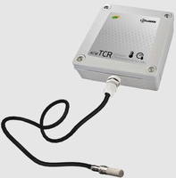

# ACW-TCR – Temperature & humidity probe with inertia



Temperature and humidity probe reporting both the instantaneous (physical) value and an inertial value that mimics the temperature of stored goods.

## Supported models

- ACW-TCR

## Documentation

| Model | Datasheet | User guide |
|---|---|---|
| ACW-TCR | [PDF](https://www.atim.com/wp-content/uploads/documentation/ACW/ACW-TCR/ENGLISH/ATIM_ACW-TCR_DS_EN.pdf) | [PDF](https://www.atim.com/wp-content/uploads/documentation/ACW/ACW-TCR/ENGLISH/ATIM_ACW-TCR_UG_EN.pdf) |

## Codec

| File | Version | Entry points |
|---|---|---|
| [acw-tcr-codec.js](acw-tcr-codec.js) | 1.0.0 | `decodeUplink`, `encodeDownlink`, `decodeDownlink` |

The same file can be pasted as is into The Things Stack (TTN v3), ChirpStack v4 and ChirpStack v3. See [platform integration](../../docs/platforms.md).

French version of this codec (French field names and labels): [../../../fr/environnement/acw-tcr](../../../fr/environnement/acw-tcr).

## Uplink fields

Measurements are returned as a number, or as an array (most recent sample first) when the frame carries history. See [output format](../../docs/output-format.md).

| Field | Description | Type | Unit |
|---|---|---|---|
| `temperature_physical` | Physical temperature | number | Cel |
| `temperature_inertial` | Inertial temperature | number | Cel |
| `humidity_physical` | Physical humidity | number | %RH |
| `humidity_inertial` | Inertial humidity | number | %RH |
| `period` | Datalogging period | number | minute |
| `voltagec` | Voltage under load (during transmission) | number | V |
| `voltagev` | Idle voltage | number | V |
| `frame_type` | Frame type | string |  |
| `alert` | Alert | string |  |
| `error` | Error | string |  |
| `timestamp` | Frame timestamp (ISO 8601 UTC) | string |  |

## Downlink commands

Pass one or more of these keys in `input.data` of `encodeDownlink`. See [downlink commands](../../docs/downlink-commands.md).

| Key | Description | Type | Accepted values |
|---|---|---|---|
| `setKeepAlivePeriod` | Keep alive period | string | Disable, Once every 10 mins, Once every hour, Once every 2 hours, Once every 4 hours, Once every 8 hours, Once every day, Once every 2 days, Once every 3 days, Once every 4 days, Once every week, Once every month (30 days) |
| `setDataloggingPeriod` | Datalogging period in minutes | number | 1 – 65535 minute |
| `setTimestamp` | Timestamp in uplinks: 0 = disabled, 1 = enabled | number | 0 – 1 |

## BACnet (MultiTech Conduit gateway)

To expose this product over BACnet on a MultiTech Conduit gateway (mPower, Payload Management license), import these two files in **Payload Management > Sensor Definitions > Import**:

| File | Role |
|---|---|
| [acw-tcr-bacnet-definition.json](acw-tcr-bacnet-definition.json) | Definition: BACnet properties, types, units, writable objects |
| [acw-tcr-bacnet-codec.js](acw-tcr-bacnet-codec.js) | Decoder/encoder: this codec, with one value per property |

Each uplink field becomes a readable BACnet object. A historised frame gives its most recent sample. See [BACnet](../../docs/bacnet.md).

## Examples

All test vectors are in [examples.json](examples.json). They are run by `npm test`.

### Uplink

**Physical and inertial temperature and humidity** – payload `a00808850917de180870191794`, fPort 1

```json
{
  "frame_type": "Measurement frame",
  "temperature_physical": 21.81,
  "temperature_inertial": 21.6,
  "humidity_physical": 61.1,
  "humidity_inertial": 60.36
}
```

**Historised physical and inertial temperature and humidity** – payload `a1003c0808a408850917a217de1808ac089819178417c0`, fPort 1

```json
{
  "frame_type": "Measurement frame",
  "period": 60,
  "temperature_physical": [
    22.12,
    21.81
  ],
  "temperature_inertial": [
    22.2,
    22
  ],
  "humidity_physical": [
    60.5,
    61.1
  ],
  "humidity_inertial": [
    60.2,
    60.8
  ]
}
```

**Keep alive frame** – payload `810e100dac`, fPort 1

```json
{
  "frame_type": "Keep alive frame",
  "voltagec": 3.5,
  "voltagev": 3.6
}
```

### Downlink

| Description | `input.data` | Bytes (hex) | fPort |
|---|---|---|---|
| Set the keep alive period to once a day | `{"setKeepAlivePeriod":"Once every day"}` | `0306` | 1 |
| Set the datalogging period to 300 minutes | `{"setDataloggingPeriod":300}` | `d403012c01` | 1 |
| Enable the timestamp in uplinks | `{"setTimestamp":1}` | `0b01` | 1 |
