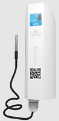

# ACW-TMxP – PT1000 temperature probes



One or two remote PT1000 temperature probes (-196 °C to +200 °C) with a configurable dry contact / counting input.

## Supported models

- ACW-TMxP

## Documentation

| Model | Datasheet | User guide |
|---|---|---|
| ACW-TM1P, ACW-TM2P | [PDF](https://www.atim.com/wp-content/uploads/documentation/ACW/ACW-TMxP/ENGLISH/ATIM_ACW-TMxP_DS_EN.pdf) | [PDF](https://www.atim.com/wp-content/uploads/documentation/ACW/ACW-TMxP/ENGLISH/ATIM_ACW-TMxP_UG_EN.pdf) |

## Codec

| File | Version | Entry points |
|---|---|---|
| [acw-tmxp-codec.js](acw-tmxp-codec.js) | 1.0.0 | `decodeUplink`, `encodeDownlink`, `decodeDownlink` |

The same file can be pasted as is into The Things Stack (TTN v3), ChirpStack v4 and ChirpStack v3. See [platform integration](../../docs/platforms.md).

French version of this codec (French field names and labels): [../../../fr/environnement/acw-tmxp](../../../fr/environnement/acw-tmxp).

## Uplink fields

Measurements are returned as a number, or as an array (most recent sample first) when the frame carries history. See [output format](../../docs/output-format.md).

| Field | Description | Type | Unit |
|---|---|---|---|
| `temperature0` | Temperature 1 (Probe 1) | number | Cel |
| `temperature1` | Temperature 2 (Probe 2) | number | Cel |
| `counter0` | Counter 1 (Channel 0) | number |  |
| `input_state0` | Input 1 | number (0/1) |  |
| `period` | Datalogging period | number | minute |
| `voltagec` | Voltage under load (during transmission) | number | V |
| `voltagev` | Idle voltage | number | V |
| `frame_type` | Frame type | string |  |
| `alert` | Alert | string |  |
| `error` | Error | string |  |
| `timestamp` | Frame timestamp (ISO 8601 UTC) | string |  |

## Downlink commands

Pass one or more of these keys in `input.data` of `encodeDownlink`. See [downlink commands](../../docs/downlink-commands.md).

| Key | Description | Type | Accepted values |
|---|---|---|---|
| `setKeepAlivePeriod` | Keep alive period | string | Disable, Once every 10 mins, Once every hour, Once every 2 hours, Once every 4 hours, Once every 8 hours, Once every day, Once every 2 days, Once every 3 days, Once every 4 days, Once every week, Once every month (30 days) |
| `setDataloggingPeriod` | Datalogging period in minutes | number | 1 – 65535 minute |
| `setTimestamp` | Timestamp in uplinks: 0 = disabled, 1 = enabled | number | 0 – 1 |

## BACnet (MultiTech Conduit gateway)

To expose this product over BACnet on a MultiTech Conduit gateway (mPower, Payload Management license), import these two files in **Payload Management > Sensor Definitions > Import**:

| File | Role |
|---|---|
| [acw-tmxp-bacnet-definition.json](acw-tmxp-bacnet-definition.json) | Definition: BACnet properties, types, units, writable objects |
| [acw-tmxp-bacnet-codec.js](acw-tmxp-bacnet-codec.js) | Decoder/encoder: this codec, with one value per property |

Each uplink field becomes a readable BACnet object. A historised frame gives its most recent sample. See [BACnet](../../docs/bacnet.md).

## Examples

All test vectors are in [examples.json](examples.json). They are run by `npm test`.

### Uplink

**Two temperature probes** – payload `a0080885180850`, fPort 1

```json
{
  "frame_type": "Measurement frame",
  "temperature0": 21.81,
  "temperature1": 21.28
}
```

**Historised temperature probes** – payload `a1003c08088508a418082308c8`, fPort 1

```json
{
  "frame_type": "Measurement frame",
  "period": 60,
  "temperature0": [
    21.81,
    22.12
  ],
  "temperature1": [
    20.83,
    22.48
  ]
}
```

**Counter and two temperature probes** – payload `a00400000014080885180850`, fPort 1

```json
{
  "frame_type": "Measurement frame",
  "temperature0": 21.81,
  "temperature1": 21.28,
  "counter0": 20
}
```

**Keep alive frame** – payload `810e100dac`, fPort 1

```json
{
  "frame_type": "Keep alive frame",
  "voltagec": 3.5,
  "voltagev": 3.6
}
```

**Digital input change of state** – payload `a00110`, fPort 1

```json
{
  "frame_type": "Measurement frame",
  "input_state0": "switched low"
}
```

### Downlink

| Description | `input.data` | Bytes (hex) | fPort |
|---|---|---|---|
| Set the keep alive period to once a day | `{"setKeepAlivePeriod":"Once every day"}` | `0306` | 1 |
| Set the datalogging period to 300 minutes | `{"setDataloggingPeriod":300}` | `d403012c01` | 1 |
| Enable the timestamp in uplinks | `{"setTimestamp":1}` | `0b01` | 1 |
