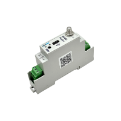

# ACW-DINRSM-V2 – Modbus master gateway



Modbus master gateway. The codec decodes heartbeat frames, periodic Modbus data (returned as raw hex) and Modbus error frames.

## Supported models

- ACW-DINRSM-V2

## Documentation

| Model | Datasheet | User guide |
|---|---|---|
| ACW-DINRSM-V2 | [PDF](https://www.atim.com/wp-content/uploads/documentation/ACW/ACW-DINRSM/ENGLISH/ATIM_ACW-DINRSM_V2_DS_EN.pdf) | [PDF](https://www.atim.com/wp-content/uploads/documentation/ACW/ACW-DINRSM/ENGLISH/ATIM_ACW-DINRSM_V2_UG_EN.pdf) |

## Codec

| File | Version | Entry points |
|---|---|---|
| [acw-dinrsm-v2-codec.js](acw-dinrsm-v2-codec.js) | 1.0.1 | `decodeUplink` |

The same file can be pasted as is into The Things Stack (TTN v3), ChirpStack v4 and ChirpStack v3. See [platform integration](../../docs/platforms.md).

French version of this codec (French field names and labels): [../../../fr/entrees-sorties/acw-dinrsm-v2](../../../fr/entrees-sorties/acw-dinrsm-v2).

## BACnet (MultiTech Conduit gateway)

To expose this product over BACnet on a MultiTech Conduit gateway (mPower, Payload Management license), import these two files in **Payload Management > Sensor Definitions > Import**:

| File | Role |
|---|---|
| [acw-dinrsm-v2-bacnet-definition.json](acw-dinrsm-v2-bacnet-definition.json) | Definition: BACnet properties, types, units, writable objects |
| [acw-dinrsm-v2-bacnet-codec.js](acw-dinrsm-v2-bacnet-codec.js) | Decoder/encoder: this codec, with one value per property |

Each uplink field becomes a readable BACnet object. A historised frame gives its most recent sample. See [BACnet](../../docs/bacnet.md).

## Examples

All test vectors are in [examples.json](examples.json). They are run by `npm test`.

### Uplink

**Example 0x01** – payload `010e100dac64`, fPort 1

```json
{
  "frameType": "HEART_BEAT",
  "radioIdleVoltage": 3600,
  "radioTransmitVoltage": 3500
}
```

**Example 0x03** – payload `0340010203`, fPort 1

```json
{
  "frameType": "PERIODIC_DATA",
  "header": 64,
  "payload": "010203"
}
```

**Example 0x83** – payload `830110fa2132195305`, fPort 1

```json
{
  "errorCode": 250,
  "errorSource": "DEVICE",
  "errorType": "TIMEOUT",
  "frameType": "ERROR",
  "functionCode": 50,
  "parameter": 1,
  "radioHeader": 16,
  "register_lsb": 83,
  "register_msb": 25,
  "register_nbr": 5,
  "slave": 33
}
```
