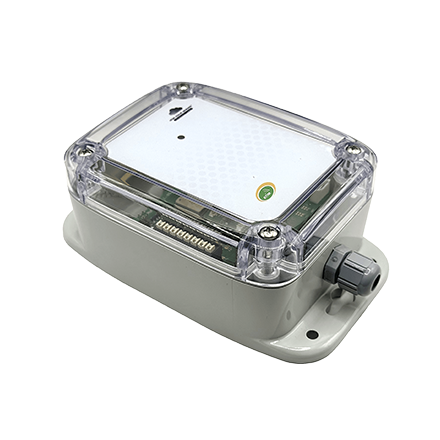

# ACW-MIO – 4-20 mA / 0-10 V analog inputs and digital inputs


Range of input modules: 4-20 mA, 0-10 V or 0-100 % analog inputs, digital inputs (change of state or pulse counting), cable cut or leak detection (WLK), and an internal temperature and humidity sensor depending on the model. Available over LoRaWAN, Sigfox, LTE-M and NB-IoT.

## Supported models

| Model | Inputs | Picture |
|---|---|---|
| ACW/MIO-C0 | 1 analog input + 1 digital input, cable gland, no cable |  |
| ACW/MIO-C1 | 1 analog input + 1 digital input, cable gland, 1 m cable |  |
| ACW/MIO-1M8 | 1 analog input + 1 digital input, 1 M8 connector |  |
| ACW/MIO-2M8 | 2 analog inputs + 2 digital inputs, 2 M8 connectors |  |
| ACW/MIO-MT1 | 1 digital or counting input |  |
| ACW/MIO-WLK | Water or fuel oil leak detection with a cable (cable voltage on analog channel 0) + temperature and humidity |  |

On the MIO-MT1, the wired input is input 2: set it with `setInput2Config`. The ACW-MT1 (product type 0x9F) has its own codec, [ACW-MT1](../acw-mt1): its frames are the same, but its configuration parameters have different numbers. The codec of the former ACW-WLL leak detector is [ACW-WLL](../../detection/acw-wll).

## Documentation

| Model | Datasheet | User guide |
|---|---|---|
| ACW-MIO (C0, C1, 1M8, 2M8) | [PDF (FR)](https://atim.com/wp-content/uploads/documentation/ACW/ACW-MIO/FRANCAIS/ATIM_ACW-MIO_DS_FR.pdf) | [PDF (FR)](https://atim.com/wp-content/uploads/documentation/ACW/ACW-MIO/FRANCAIS/ATIM_ACW-MIO_UG_FR.pdf) |
| ACW-WLK | [PDF (FR)](https://www.atim.com/wp-content/uploads/documentation/ACW/ACW-WLK/FRANCAIS/ATIM_ACW-WLK_DS_FR.pdf) | [PDF (FR)](https://www.atim.com/wp-content/uploads/documentation/ACW/ACW-WLK/FRANCAIS/ATIM_ACW-WLK_UG_FR.pdf) |

Documents marked (FR) are only available in French.

## Codec

| File | Version | Entry points |
|---|---|---|
| [acw-mio-codec.js](acw-mio-codec.js) | 1.0.0 | `decodeUplink`, `encodeDownlink`, `decodeDownlink` |

The same file can be pasted as is into The Things Stack (TTN v3), ChirpStack v4 and ChirpStack v3. See [platform integration](../../docs/platforms.md).

French version of this codec (French field names and labels): [../../../fr/entrees-sorties/acw-mio](../../../fr/entrees-sorties/acw-mio).

## Uplink fields

Measurements are returned as a number, or as an array (most recent sample first) when the frame carries history. See [output format](../../docs/output-format.md). Analog channels are numbered from 0: channel 0 is the SIG1 analog input, channel 1 the SIG2 input (2M8).

| Field | Description | Type | Unit |
|---|---|---|---|
| `current0` … `current1` | Current of a 4-20 mA input | number | mA |
| `voltage0` … `voltage1` | Voltage of a 0-10 V input | number | V |
| `rate0` … `rate1` | Percentage of a 0-100 % input | number | % |
| `input_state0` … `input_state3` | Digital input state: 1/0 in periodic frames; `"switched high"`, `"switched low"`, `"high"` or `"low"` in change of state frames | number |  |
| `counter0` … `counter3` | Counter index of the input with the same number (0 = input 1) | number |  |
| `temperature0` | Internal sensor temperature | number | Cel |
| `humidity0` | Internal sensor humidity | number | %RH |
| `temperature1`, `humidity1` | External sensor temperature and humidity, when it is enabled in the configurator | number | Cel, %RH |
| `cable_cut` | Cable cut (input in "Wirecut" mode): 1 = cable cut, 0 = cable restored | number |  |
| `period` | Transmission period | number | minute |
| `voltagec` | Voltage under load (during transmission) | number | V |
| `voltagev` | Idle voltage | number | V |
| `frame_type` | Frame type | string |  |
| `alert` | Threshold alert, for example "High threshold exceeded on current channel 0" | string |  |
| `error` | Error | string |  |
| `timestamp` | Frame timestamp (ISO 8601 UTC) | string |  |

Over LTE-M and NB-IoT, the extended measurement frame adds `frame_index`, and the keep alive frame can carry the GPS position (`gps_status`, `latitude`, `longitude`). See [output format](../../docs/output-format.md#lte-m--nb-iot-products).

### Command responses

| Field | Description | Type | Unit |
|---|---|---|---|
| `configuration_accepted` | 1 if every parameter was accepted, 0 otherwise | number |  |
| `rejected_parameters` | Position (from 1) of the rejected parameters in the sent frame | list |  |
| `downlink_error` | Downlink frame rejected: reason | string |  |
| `command` | Number of the command the product answers | number |  |
| `config_input1` … `config_input4` | Input configuration read back, for example "Digital input, pull-up, rising edge" | string |  |
| `keep_alive_period` | Keep alive period read back | string |  |
| `timestamp_enabled` | Uplink timestamp read back: 0 or 1 | number |  |

## Downlink commands

Pass one or more of these keys in `input.data` of `encodeDownlink`. See [downlink commands](../../docs/downlink-commands.md).

| Key | Description | Type | Accepted values |
|---|---|---|---|
| `setKeepAlivePeriod` | Keep alive period | string | Disable, Once every hour, Once every day… (see [downlink commands](../../docs/downlink-commands.md)) |
| `setDataloggingPeriod` | Transmission period in minutes | number | 1 – 65535 minute |
| `setTimestamp` | Timestamp in uplinks: 0 = disabled, 1 = enabled | number | 0 – 1 |
| `setInput1Config` … `setInput4Config` | Role of an input (see below) | object | `{ mode, analogType, pull, trigger }` or the configuration byte |
| `setAnalog1Threshold`, `setAnalog2Threshold` | Thresholds of analog input 1 (SIG1) or 2 (SIG2) | object | `{ analogType, high, low, hysteresis, duration, fastTxPeriod }` |
| `setAnalog1Calibration`, `setAnalog2Calibration` | Calibration of an analog input | object | `{ analogType, offset, coefficient }` |
| `setTemperatureCalibration` | Calibration of the internal temperature sensor, offset in °C | object | `{ offset, coefficient }` |
| `setCounter1` … `setCounter4` | Sets the value of a counter. Send it alone. | number | 0 – 4294967295 |
| `getConfiguration` | Reads back the keep alive, timestamp, datalogging and the 4 inputs. Send it alone. | number | 1 |

### Input configuration

| `mode` | Role | Other keys |
|---|---|---|
| `"disabled"` | Input disabled | |
| `"edge"` | Digital input: a frame is sent on every edge | `pull`: `"none"` (default), `"up"`, `"down"`; `trigger`: `"rising"`, `"falling"`, `"both"` (default) |
| `"counter"` | Pulse counting, on the counter with the same number as the input | `pull`, `trigger` (default `"rising"`) |
| `"analog"` | Analog input | `analogType`: `"4-20mA"`, `"0-10V"` or `"0-100%"` |
| `"wirecut"` | Cable cut detection | |

The 4-20 mA or 0-10 V type must also be set with the dip switch of the board (see the user guide).

### Thresholds and calibration

- Values are in the unit of the input, given by `analogType`: mA for 4-20 mA, V for 0-10 V, % for 0-100 %.
- `duration`: confirmation time of the crossing in seconds (0 disables the threshold, 1 by default). `fastTxPeriod`: transmission period in minutes while the threshold is crossed (0 = unchanged, by default).
- The calibration applies `value = offset + measurement × coefficient` (coefficient 1 by default).

## BACnet (MultiTech Conduit gateway)

To expose this product over BACnet on a MultiTech Conduit gateway (mPower, Payload Management license), import these two files in **Payload Management > Sensor Definitions > Import**:

| File | Role |
|---|---|
| [acw-mio-bacnet-definition.json](acw-mio-bacnet-definition.json) | Definition: BACnet properties, types, units, writable objects |
| [acw-mio-bacnet-codec.js](acw-mio-bacnet-codec.js) | Decoder/encoder: this codec, with one value per property |

Each uplink field becomes a readable BACnet object. A historised frame gives its most recent sample. See [BACnet](../../docs/bacnet.md).

Writable: `setKeepAlivePeriod`, `setDataloggingPeriod`, `setTimestamp`, `setInput1Config` … `setInput4Config` (configuration byte), `setCounter1` … `setCounter4` and `getConfiguration`. The `inputConfigHelp` text object recalls the format of the configuration byte. Thresholds and calibration, which need several values, are set with the configurator or with `encodeDownlink`.

## Examples

All test vectors are in [examples.json](examples.json). They are run by `npm test`.

### Uplink

**4-20 mA current on input 1** – payload `a00b0578`, fPort 1

```json
{
  "frame_type": "Measurement frame",
  "current0": 14
}
```

**Historised current and voltage, 2 samples** – payload `a1003c0b03e804b01a09600974`, fPort 1

```json
{
  "frame_type": "Measurement frame",
  "period": 60,
  "current0": [
    10,
    12
  ],
  "voltage1": [
    2.4,
    2.42
  ]
}
```

**Internal sensor temperature and humidity** – payload `a00b0578080a12090e30`, fPort 1

```json
{
  "frame_type": "Measurement frame",
  "current0": 14,
  "temperature0": 25.78,
  "humidity0": 36.32
}
```

**Digital inputs and counter of input 1** – payload `a001010400000052`, fPort 1

```json
{
  "frame_type": "Measurement frame",
  "counter0": 82,
  "input_state0": 1,
  "input_state1": 0,
  "input_state2": 0,
  "input_state3": 0
}
```

**Input 1 change of state** – payload `a00111`, fPort 1

```json
{
  "frame_type": "Measurement frame",
  "input_state0": "switched high",
  "input_state1": "low",
  "input_state2": "low",
  "input_state3": "low"
}
```

**Percentage on input 1** – payload `a00c1388`, fPort 1

```json
{
  "frame_type": "Measurement frame",
  "rate0": 50
}
```

**Extended measurement frame (LTE-M / NB-IoT)** – payload `8900000001010001003c0a1388`, fPort 1

```json
{
  "frame_type": "Extended measurement frame",
  "frame_index": 1,
  "period": 60,
  "voltage0": 5
}
```

**Timestamped extended measurement frame, history of 2 samples** – payload `c96a803ba600000001020002003c0a13881482151c157c1a0bb80c1c0c800ce4`, fPort 1

```json
{
  "frame_type": "Extended measurement frame",
  "frame_index": 1,
  "period": 60,
  "voltage0": [
    5,
    5.25,
    5.404,
    5.5
  ],
  "voltage1": [
    3,
    3.1,
    3.2,
    3.3
  ],
  "timestamp": "2026-08-15T10:12:54.000Z"
}
```

**Alert: high threshold exceeded, current of input 1** – payload `8d4b03e8`, fPort 1

```json
{
  "frame_type": "Alert frame",
  "current0": 10,
  "alert": "High threshold exceeded on current channel 0"
}
```

**End of alert: voltage of input 2 back within the thresholds** – payload `8d1a1194`, fPort 1

```json
{
  "frame_type": "Alert frame",
  "voltage1": 4.5,
  "alert": "Back within thresholds on voltage channel 1"
}
```

**WLK: detection cable voltage, temperature and humidity** – payload `a00a0010080a12090e30`, fPort 1

```json
{
  "frame_type": "Measurement frame",
  "voltage0": 0.016,
  "temperature0": 25.78,
  "humidity0": 36.32
}
```

**WLK: leak detected (cable voltage above the high threshold)** – payload `8d4a02c9`, fPort 1

```json
{
  "frame_type": "Alert frame",
  "voltage0": 0.713,
  "alert": "High threshold exceeded on voltage channel 0"
}
```

**WLK: end of leak alert** – payload `8d0a0010`, fPort 1

```json
{
  "frame_type": "Alert frame",
  "voltage0": 0.016,
  "alert": "Back within thresholds on voltage channel 0"
}
```

**Cable cut detected** – payload `8f1c20`, fPort 1

```json
{
  "frame_type": "Specific frame",
  "cable_cut": 1
}
```

**Cable restored** – payload `8f1c01`, fPort 1

```json
{
  "frame_type": "Specific frame",
  "cable_cut": 0
}
```

**Keep alive frame** – payload `810d240c68`, fPort 1

```json
{
  "frame_type": "Keep alive frame",
  "voltagec": 3.176,
  "voltagev": 3.364
}
```

**Keep alive frame with GPS position (LTE-M / NB-IoT)** – payload `810d240c6803293ee90513c6`, fPort 1

```json
{
  "frame_type": "Keep alive frame",
  "voltagec": 3.176,
  "voltagev": 3.364,
  "gps_status": "Position found",
  "latitude": 45.05135,
  "longitude": 5.5457
}
```

**Configuration accepted** – payload `8600`, fPort 1

```json
{
  "frame_type": "Response to a configuration frame",
  "configuration_accepted": 1,
  "rejected_parameters": []
}
```

**Input configuration read-back** – payload `87041a161b5121262200`, fPort 1

```json
{
  "frame_type": "Response to a command frame",
  "command": 4,
  "config_input1": "Analog input, 4-20 mA",
  "config_input2": "Digital input, pull-up, rising edge",
  "config_input3": "Analog input, 0-10 V",
  "config_input4": "Disabled"
}
```

**Downlink error: unknown parameter** – payload `8803`, fPort 1

```json
{
  "frame_type": "Response to an invalid frame",
  "downlink_error": "Unknown parameter"
}
```

### Downlink

| Description | `input.data` | Bytes (hex) | fPort |
|---|---|---|---|
| Set the keep alive period to once a day | `{"setKeepAlivePeriod":"Once every day"}` | `0306` | 1 |
| Set the datalogging period to 300 minutes | `{"setDataloggingPeriod":300}` | `d403012c01` | 1 |
| Enable the timestamp in uplinks | `{"setTimestamp":1}` | `0b01` | 1 |
| Set input 1 to 4-20 mA | `{"setInput1Config":{"mode":"analog","analogType":"4-20mA"}}` | `1a16` | 1 |
| Set input 3 to 0-10 V | `{"setInput3Config":{"mode":"analog","analogType":"0-10V"}}` | `2126` | 1 |
| Set input 2 to digital input, pull-up, rising and falling edges | `{"setInput2Config":{"mode":"edge","pull":"up","trigger":"both"}}` | `1bd1` | 1 |
| Set input 2 to counter | `{"setInput2Config":{"mode":"counter"}}` | `1b43` | 1 |
| Disable input 4 | `{"setInput4Config":{"mode":"disabled"}}` | `2200` | 1 |
| Analog input 1 threshold: 4-10 mA, 0.5 mA hysteresis | `{"setAnalog1Threshold":{"analogType":"4-20mA","high":10,"low":4,"hysteresis":0.5,"duration":1}}` | `d50900e803900132000100` | 1 |
| Analog input 2 threshold: 0-5 V, transmission every 5 min during an alert | `{"setAnalog2Threshold":{"analogType":"0-10V","high":5,"low":0,"hysteresis":1.5,"duration":1,"fastTxPeriod":5}}` | `e4090088130000dc050105` | 1 |
| Analog input 1 calibration: 0.1 mA offset, coefficient 1 | `{"setAnalog1Calibration":{"analogType":"4-20mA","offset":0.1,"coefficient":1}}` | `d805000a00e803` | 1 |
| Internal temperature sensor calibration: 0.40 °C offset | `{"setTemperatureCalibration":{"offset":0.4,"coefficient":1}}` | `d905002800e803` | 1 |
| Set counter 2 to 3728 | `{"setCounter2":3728}` | `c1061102900e0000` | 1 |
| Read the configuration back | `{"getConfiguration":true}` | `c10804030b141a1b2122` | 1 |
