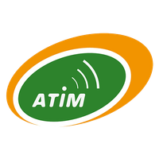

# Codecs LoRaWAN ATIM – Français

Décodeurs de trames et encodeurs de commandes pour la gamme LoRaWAN **ATIM ACW**, avec une **sortie en français** (noms de champs et libellés).

*English version: [../en](../en/README.md)*

Chaque codec est un fichier JavaScript unique, conforme à la
[LoRaWAN Payload Codec API (TS013)](https://resources.lora-alliance.org/technical-specifications/ts013-1-0-0-payload-codec-api).
Il est autonome et sans dépendance : copiez-le dans votre serveur réseau ou chargez-le depuis Node.js.

## Plateformes compatibles

| Plateforme | Utilisation du codec |
|---|---|
| The Things Stack (TTN v3) | Coller le fichier comme *Custom Javascript formatter* (montant et descendant) |
| ChirpStack v4 | Coller le fichier dans l’onglet *Codec* du profil d’équipement |
| ChirpStack v3 | Même fichier : les adaptateurs `Decode` / `Encode` sont inclus |
| MultiTech Conduit (BACnet) | Importer `<produit>-bacnet-definition.json` et `<produit>-bacnet-codec.js`, voir [docs/bacnet.md](docs/bacnet.md) |
| Node.js | `require()` du fichier |

La procédure détaillée est dans [docs/plateformes.md](docs/plateformes.md).

## Équipements

### Environnement

| Équipement | Description | Codec |
|---|---|---|
| ACW-TH, TH-I, TH-I v2, TH-O | Capteur de température et d’humidité | [environnement/acw-thx](environnement/acw-thx) |
| ACW-THAQ | Qualité d’air intérieur (température, humidité, CO2, COV) | [environnement/acw-thaq](environnement/acw-thaq) |
| ACW-TCR | Sonde de température et d’humidité à mesure inertielle | [environnement/acw-tcr](environnement/acw-tcr) |
| ACW-TMxP | Une ou deux sondes de température PT1000 | [environnement/acw-tmxp](environnement/acw-tmxp) |
| ACW-PTMxP | Transmetteur de pression différentielle | [environnement/acw-ptmxp](environnement/acw-ptmxp) |
| ACW-PW | Contrôle de chauffage par fil pilote | [environnement/acw-pw](environnement/acw-pw) |

### Comptage

| Équipement | Description | Codec |
|---|---|---|
| ACW-MR2-EX, ACW-MR2 | Compteur d’impulsions ATEX, un ou deux compteurs | [comptage/acw-mr2-ex](comptage/acw-mr2-ex) |
| ACW-MR4 | Compteur d’impulsions et contacts secs, jusqu’à quatre entrées | [comptage/acw-mr4](comptage/acw-mr4) |
| ACW-MR4-OPTO | Lecteur optique de compteur | [comptage/acw-mr4-opto](comptage/acw-mr4-opto) |

### Mesure

| Équipement | Description | Codec |
|---|---|---|
| ACW-CTS | Capteur de courant autoalimenté | [mesure/acw-cts](mesure/acw-cts) |
| ACW-GAUG | Jauge de niveau de cuve | [mesure/acw-gaug](mesure/acw-gaug) |

### Détection

| Équipement | Description | Codec |
|---|---|---|
| ACW-PIRxx | Détecteur de mouvement | [detection/acw-pir](detection/acw-pir) |
| ACW-WLL | Détecteur de fuite | [detection/acw-wll](detection/acw-wll) |

### Entrées/sorties & passerelles

| Équipement | Description | Codec |
|---|---|---|
| ACW-DINDxx (DIND21) | Module d’entrées/sorties digitales | [entrees-sorties/acw-dind21](entrees-sorties/acw-dind21) |
| ACW-DINDxx / DINDx0 (DIND88) | Module d’entrées digitales et analogiques | [entrees-sorties/acw-dind88](entrees-sorties/acw-dind88) |
| ACW-DINRSM-V2 | Passerelle maître Modbus | [entrees-sorties/acw-dinrsm-v2](entrees-sorties/acw-dinrsm-v2) |
| ACW-MIO (C0, C1, 1M8, 2M8, MT1, WLK) | Entrées analogiques 4-20 mA / 0-10 V et entrées TOR | [entrees-sorties/acw-mio](entrees-sorties/acw-mio) |
| ACW-MT1 | Entrée TOR ou comptage | [entrees-sorties/acw-mt1](entrees-sorties/acw-mt1) |

### Décodeur générique

| Équipement | Description | Codec |
|---|---|---|
| Autre produit ACW (ACW-LVL…) | Décode toutes les trames de la gamme ACW sans connaître le produit : champs nommés par type de mesure et par voie | [generique/acw-generic](generique/acw-generic) |

## Démarrage rapide (Node.js)

```js
const codec = require("./environnement/acw-thx/acw-thx-codec.js");

console.log(codec.decodeUplink({ bytes: [0xa0, 0x08, 0x08, 0x85, 0x09, 0x17, 0xde], fPort: 1 }));
// { data: { frame_type: "Trame de mesure", temperature0: 21.81, humidity0: 61.1 }, errors: [], warnings: [] }

console.log(codec.encodeDownlink({ data: { setKeepAlivePeriod: "Tous les jours" } }));
// { bytes: [3, 6], fPort: 1, warnings: [], errors: [] }
```

## Conventions de sortie

- Une mesure est un **nombre**. Quand la trame contient un historique, c’est un **tableau, échantillon le plus récent en premier**.
- `horodatage` (quand l’horodatage est activé sur le produit) est une chaîne ISO 8601 en UTC.
- `errors` est renseigné pour les trames vides, illisibles ou de type inconnu.

Les détails sont dans [docs/format-de-sortie.md](docs/format-de-sortie.md), et les commandes descendantes dans [docs/commandes-descendantes.md](docs/commandes-descendantes.md).

## Organisation des dossiers

```
<famille>/<produit>/
├── README.md              champs, commandes descendantes et exemples
├── <produit>-codec.js     le codec (décodeur + encodeur)
├── <produit>-bacnet-definition.json, <produit>-bacnet-codec.js
│                          fichiers BACnet pour la passerelle MultiTech Conduit
├── <produit>.png          photo du produit
├── examples.json          cas de test : trame -> sortie attendue
└── product.json           métadonnées (modèles, version, points d’entrée)
products.json              index de tous les produits
docs/                      documentation commune
```

## Tests

Chaque `examples.json` est rejoué sur son codec, sous Node.js et dans un bac à sable JavaScript proche des environnements de TTN et ChirpStack. À lancer depuis la racine du dépôt :

```sh
npm test                 # tous les produits, dans les deux langues
npm test -- acw-thx      # un seul produit
```

Les exemples peuvent aussi être exécutés dans les vrais moteurs JavaScript des serveurs réseau :

| Commande | Moteur | Serveur réseau |
|---|---|---|
| `npm run test:ttn` | goja | The Things Stack (TTN v3) |
| `npm run test:chirpstack-v3` | otto (ES5 uniquement) | ChirpStack v3 |
| `npm run test:chirpstack-v4` | QuickJS (script et module ES) | ChirpStack v4 |
| `npm run test:lns` | les trois | |

`test:chirpstack-v4` demande un `npm install`. `test:ttn` et `test:chirpstack-v3` demandent [Go](https://go.dev/dl/) 1.22 ou plus récent, ou Docker :

```sh
docker run --rm -v "$PWD:/repo" -w /repo/scripts/lns/go golang:1.22 go run . ../../.. ttn
```

Toutes sont lancées à chaque push par la CI GitHub.

## Contribuer

Les signalements de bugs et les nouveaux cas de test sont les bienvenus : voir [CONTRIBUTING.md](CONTRIBUTING.md). Les évolutions sont listées dans [CHANGELOG.md](CHANGELOG.md).

## Licence

[MIT](../LICENSE) – Copyright (c) 2026 ATIM.
