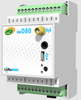

# ACW-DINDxx (DIND88) – Module d’entrées digitales et analogiques



Module d’entrées : états de contacts secs, index de comptage, états des sorties et entrées analogiques (0-10 V, 4-20 mA).

## Modèles couverts

- ACW-DINDx0
- ACW-DINDxx

## Documentation

| Modèle | Fiche technique | Guide utilisateur |
|---|---|---|
| ACW-DIND88, DIND80, DIND160, DIND44 | [PDF](https://www.atim.com/wp-content/uploads/documentation/ACW/ACW-DIND%20(80%2C44%2C160%2C88)/FRANCAIS/ATIM_ACW-DINDxxx_DS_FR.pdf) | [PDF](https://www.atim.com/wp-content/uploads/documentation/ACW/ACW-DIND%20(80%2C44%2C160%2C88)/FRANCAIS/ATIM_ACW-DINDxxx_UG_FR.pdf) |

## Codec

| Fichier | Version | Points d’entrée |
|---|---|---|
| [acw-dind88-codec.js](acw-dind88-codec.js) | 1.0.0 | `decodeUplink`, `encodeDownlink`, `decodeDownlink` |

Le même fichier se colle tel quel dans The Things Stack (TTN v3), ChirpStack v4 et ChirpStack v3. Voir [intégration aux plateformes](../../docs/plateformes.md).

Version anglaise de ce codec (champs et libellés en anglais) : [../../../en/io-modules/acw-dind88](../../../en/io-modules/acw-dind88).

## Champs remontés

Une mesure est un nombre, ou un tableau (échantillon le plus récent en premier) quand la trame contient un historique. Voir [format de sortie](../../docs/format-de-sortie.md).

| Champ | Description | Type | Unité |
|---|---|---|---|
| `temperature0` | Température 1 | nombre | Cel |
| `tension` | Tension (entrée 0-10 V) | nombre | V |
| `current` | Courant (entrée 4-20 mA) | nombre | mA |
| `voltagec` | Tension en charge (pendant l’émission) | nombre | V |
| `voltagev` | Tension à vide | nombre | V |
| `compteur0` | Compteur 1 (voie 0) | nombre |  |
| `compteur1` | Compteur 2 (voie 1) | nombre |  |
| `compteur2` | Compteur 3 (voie 2) | nombre |  |
| `compteur3` | Compteur 4 (voie 3) | nombre |  |
| `compteur4` | Compteur 5 (voie 4) | nombre |  |
| `compteur5` | Compteur 6 (voie 5) | nombre |  |
| `compteur6` | Compteur 7 (voie 6) | nombre |  |
| `compteur7` | Compteur 8 (voie 7) | nombre |  |
| `input_state0` | Entrée 1 | nombre (0/1) |  |
| `input_state1` | Entrée 2 | nombre (0/1) |  |
| `input_state2` | Entrée 3 | nombre (0/1) |  |
| `input_state3` | Entrée 4 | nombre (0/1) |  |
| `input_state4` | Entrée 5 | nombre (0/1) |  |
| `input_state5` | Entrée 6 | nombre (0/1) |  |
| `input_state6` | Entrée 7 | nombre (0/1) |  |
| `input_state7` | Entrée 8 | nombre (0/1) |  |
| `input_state8` | Entrée 9 | nombre (0/1) |  |
| `input_state9` | Entrée 10 | nombre (0/1) |  |
| `input_state10` | Entrée 11 | nombre (0/1) |  |
| `input_state11` | Entrée 12 | nombre (0/1) |  |
| `input_state12` | Entrée 13 | nombre (0/1) |  |
| `input_state13` | Entrée 14 | nombre (0/1) |  |
| `input_state14` | Entrée 15 | nombre (0/1) |  |
| `input_state15` | Entrée 16 | nombre (0/1) |  |
| `output_state0` | Sortie 1 | nombre (0/1) |  |
| `output_state1` | Sortie 2 | nombre (0/1) |  |
| `output_state2` | Sortie 3 | nombre (0/1) |  |
| `output_state3` | Sortie 4 | nombre (0/1) |  |
| `output_state4` | Sortie 5 | nombre (0/1) |  |
| `output_state5` | Sortie 6 | nombre (0/1) |  |
| `output_state6` | Sortie 7 | nombre (0/1) |  |
| `output_state7` | Sortie 8 | nombre (0/1) |  |
| `frame_type` | Type de trame | texte |  |
| `alerte` | Alerte | texte |  |
| `erreur` | Erreur | texte |  |

## Commandes descendantes

Passez une ou plusieurs de ces clés dans `input.data` de `encodeDownlink`. Voir [commandes descendantes](../../docs/commandes-descendantes.md).

| Clé | Description | Type | Valeurs acceptées |
|---|---|---|---|
| `setKeepAlivePeriod` | Période de la trame de vie | texte | Disable / Désactivé, Once every 10 mins / Toutes les 10 minutes, Once every hour / Toutes les heures, Once every 2 hours / Toutes les 2 heures, Once every 4 hours / Toutes les 4 heures, Once every 8 hours / Toutes les 8 heures, Once every day / Tous les jours, Once every 2 days / Tous les 2 jours, Once every 3 days / Tous les 3 jours, Once every 4 days / Tous les 4 jours, Once every week / Toutes les semaines, Once every month (30 days) / Tous les mois (30 jours) |
| `setDataloggingPeriod` | Période d’enregistrement en minutes | nombre | 1 – 65535 minutes |
| `setTimestamp` | Horodatage des trames montantes : 0 = désactivé, 1 = activé | nombre | 0 – 1 |

## BACnet (passerelle MultiTech Conduit)

Pour exposer ce produit en BACnet sur une passerelle MultiTech Conduit (mPower, licence Payload Management), importez ces deux fichiers dans **Payload Management > Sensor Definitions > Import** :

| Fichier | Rôle |
|---|---|
| [acw-dind88-bacnet-definition.json](acw-dind88-bacnet-definition.json) | Définition : propriétés BACnet, types, unités, objets en écriture |
| [acw-dind88-bacnet-codec.js](acw-dind88-bacnet-codec.js) | Décodeur/encodeur : ce codec, avec une seule valeur par propriété |

Chaque champ remonté devient un objet BACnet en lecture. Une trame historisée donne l’échantillon le plus récent. Voir [BACnet](../../docs/bacnet.md).

## Exemples

Tous les cas de test sont dans [examples.json](examples.json). Ils sont exécutés par `npm test`.

### Trames montantes

**Entrées et sorties digitales, deux compteurs** – payload `6ff50a00006386000d5454`, fPort 1

```json
{
  "frame_type": "Trame d’entrées/sorties digitales, compteur 1 et compteur 2",
  "compteur1": 25478,
  "compteur2": 873556,
  "output_state0": 0,
  "output_state1": 1,
  "output_state2": 0,
  "output_state3": 1,
  "output_state4": 0,
  "output_state5": 0,
  "output_state6": 0,
  "output_state7": 0,
  "input_state0": 1,
  "input_state1": 0,
  "input_state2": 1,
  "input_state3": 0,
  "input_state4": 1,
  "input_state5": 1,
  "input_state6": 1,
  "input_state7": 1
}
```

**Entrées digitales, température et compteur** – payload `4ef5ff00fa00017ce6`, fPort 1

```json
{
  "frame_type": "Trame d’entrées digitales,température et compteur 1",
  "temperature0": 25,
  "compteur1": 97510,
  "input_state0": 1,
  "input_state1": 0,
  "input_state2": 1,
  "input_state3": 0,
  "input_state4": 1,
  "input_state5": 1,
  "input_state6": 1,
  "input_state7": 1,
  "input_state8": 1,
  "input_state9": 1,
  "input_state10": 1,
  "input_state11": 1,
  "input_state12": 1,
  "input_state13": 1,
  "input_state14": 1,
  "input_state15": 1
}
```

**Trame de vie** – payload `810e100dac`, fPort 1

```json
{
  "frame_type": "Trame de vie",
  "voltagec": 3.5,
  "voltagev": 3.6
}
```

**Entrée analogique 0-10 V** – payload `18007d78`, fPort 1

```json
{
  "frame_type": "Trame de relevé périodique d'une valeur 0-10V",
  "logic_level_dinda": 0,
  "tension": 5
}
```

**Entrée analogique 4-20 mA** – payload `19006f86`, fPort 1

```json
{
  "frame_type": "Trame de relevé périodique d'une valeur 0- 20mA",
  "logic_level_dinda": 0,
  "current": 12
}
```

### Trames descendantes

| Description | `input.data` | Octets (hex) | fPort |
|---|---|---|---|
| Trame de vie une fois par jour | `{"setKeepAlivePeriod":"Once every day"}` | `0306` | 1 |
| Période d'enregistrement à 300 minutes | `{"setDataloggingPeriod":300}` | `d403012c01` | 1 |
| Activer l'horodatage des trames montantes | `{"setTimestamp":1}` | `0b01` | 1 |
| Trame de vie une fois par jour (valeur en français) | `{"setKeepAlivePeriod":"Tous les jours"}` | `0306` | 1 |
