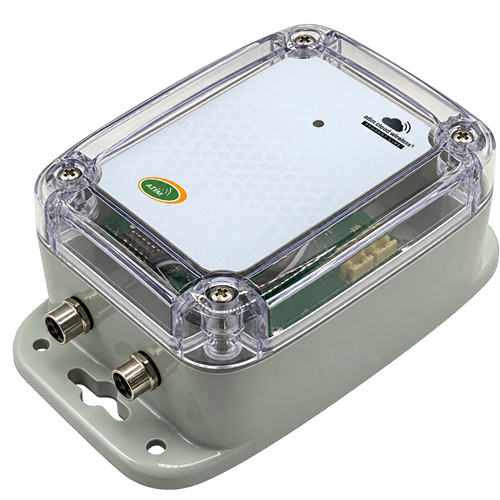
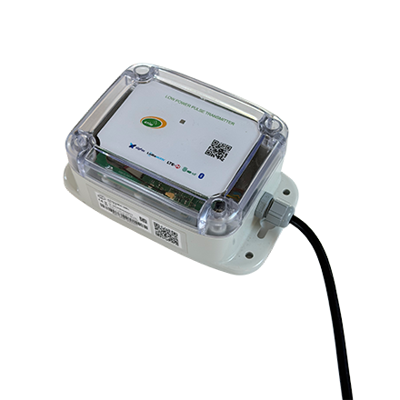
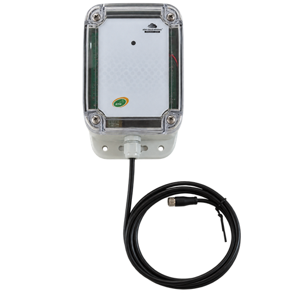
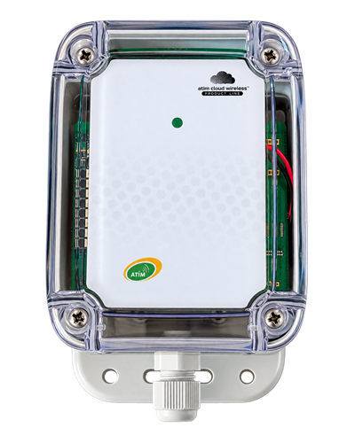
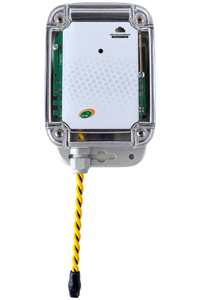

# ACW-MIO – Entrées analogiques 4-20 mA / 0-10 V et entrées TOR



Gamme de modules d’entrées : entrées analogiques 4-20 mA, 0-10 V ou 0-100 %, entrées tout ou rien (changement d’état ou comptage), détection de coupure de câble ou de fuite (WLK), capteur de température et d’humidité interne selon le modèle. Disponible en LoRaWAN, Sigfox, LTE-M et NB-IoT.

## Modèles couverts

| Modèle | Entrées | Photo |
|---|---|---|
| ACW/MIO-C0 | 1 entrée analogique + 1 entrée TOR, presse-étoupe, sans câble |  |
| ACW/MIO-C1 | 1 entrée analogique + 1 entrée TOR, presse-étoupe, câble 1 m |  |
| ACW/MIO-1M8 | 1 entrée analogique + 1 entrée TOR, 1 connecteur M8 |  |
| ACW/MIO-2M8 | 2 entrées analogiques + 2 entrées TOR, 2 connecteurs M8 |  |
| ACW/MIO-MT1 | 1 entrée TOR ou comptage |  |
| ACW/MIO-WLK | Détection de fuite d’eau ou de fuel par câble (tension du câble sur la voie analogique 0) + température et humidité |  |

Sur le MIO-MT1, l’entrée câblée est l’entrée 2 : elle se règle avec `setInput2Config`. L’ACW-MT1 (type produit 0x9F) a son propre codec, [ACW-MT1](../acw-mt1) : ses trames sont les mêmes, mais ses paramètres de configuration n’ont pas les mêmes numéros. Le codec de l’ancien détecteur de fuite ACW-WLL est [ACW-WLL](../../detection/acw-wll).

## Documentation

| Modèle | Fiche technique | Guide utilisateur |
|---|---|---|
| ACW-MIO (C0, C1, 1M8, 2M8) | [PDF](https://atim.com/wp-content/uploads/documentation/ACW/ACW-MIO/FRANCAIS/ATIM_ACW-MIO_DS_FR.pdf) | [PDF](https://atim.com/wp-content/uploads/documentation/ACW/ACW-MIO/FRANCAIS/ATIM_ACW-MIO_UG_FR.pdf) |
| ACW-WLK | [PDF](https://www.atim.com/wp-content/uploads/documentation/ACW/ACW-WLK/FRANCAIS/ATIM_ACW-WLK_DS_FR.pdf) | [PDF](https://www.atim.com/wp-content/uploads/documentation/ACW/ACW-WLK/FRANCAIS/ATIM_ACW-WLK_UG_FR.pdf) |

## Codec

| Fichier | Version | Points d’entrée |
|---|---|---|
| [acw-mio-codec.js](acw-mio-codec.js) | 1.0.0 | `decodeUplink`, `encodeDownlink`, `decodeDownlink` |

Le même fichier se colle tel quel dans The Things Stack (TTN v3), ChirpStack v4 et ChirpStack v3. Voir [intégration aux plateformes](../../docs/plateformes.md).

Version anglaise de ce codec (champs et libellés en anglais) : [../../../en/io-modules/acw-mio](../../../en/io-modules/acw-mio).

## Champs remontés

Une mesure est un nombre, ou un tableau (échantillon le plus récent en premier) quand la trame contient un historique. Voir [format de sortie](../../docs/format-de-sortie.md). Les voies analogiques sont numérotées à partir de 0 : la voie 0 est l’entrée analogique SIG1, la voie 1 l’entrée SIG2 (2M8).

| Champ | Description | Type | Unité |
|---|---|---|---|
| `courant0` … `courant1` | Courant d’une entrée en 4-20 mA | nombre | mA |
| `tension0` … `tension1` | Tension d’une entrée en 0-10 V | nombre | V |
| `taux0` … `taux1` | Pourcentage d’une entrée en 0-100 % | nombre | % |
| `input_state0` … `input_state3` | État des entrées TOR : 1/0 dans les trames périodiques ; `"mise à l'état haut"`, `"mise à l'état bas"`, `"état haut"` ou `"état bas"` dans les trames de changement d’état | nombre |  |
| `compteur0` … `compteur3` | Index du compteur de l’entrée de même numéro (0 = entrée 1) | nombre |  |
| `temperature0` | Température du capteur interne | nombre | Cel |
| `humidity0` | Humidité du capteur interne | nombre | %RH |
| `temperature1`, `humidity1` | Température et humidité du capteur externe, quand il est activé dans le configurateur | nombre | Cel, %RH |
| `cable_coupe` | Coupure de câble (entrée en mode « Wirecut ») : 1 = câble coupé, 0 = câble rétabli | nombre |  |
| `periode` | Période d’émission | nombre | minute |
| `voltagec` | Tension en charge (pendant l’émission) | nombre | V |
| `voltagev` | Tension à vide | nombre | V |
| `frame_type` | Type de trame | texte |  |
| `alerte` | Alerte de seuil, par exemple « Dépassement du seuil haut sur le courant voie 0 » | texte |  |
| `erreur` | Erreur | texte |  |
| `horodatage` | Horodatage de la trame (ISO 8601 UTC) | texte |  |

En LTE-M et NB-IoT, la trame de mesure étendue ajoute `index_trame`, et la trame de vie peut contenir la position GPS (`etat_gps`, `latitude`, `longitude`). Voir [format de sortie](../../docs/format-de-sortie.md#produits-en-lte-m--nb-iot).

### Réponses aux commandes

| Champ | Description | Type | Unité |
|---|---|---|---|
| `configuration_acceptee` | 1 si tous les paramètres ont été acceptés, 0 sinon | nombre |  |
| `parametres_refuses` | Position (à partir de 1) des paramètres refusés dans la trame envoyée | liste |  |
| `erreur_downlink` | Trame descendante refusée : cause | texte |  |
| `commande` | Numéro de la commande à laquelle le produit répond | nombre |  |
| `config_entree1` … `config_entree4` | Configuration relue d’une entrée, par exemple « Entrée TOR, tirage haut, front montant » | texte |  |
| `periode_trame_vie` | Période de la trame de vie relue | texte |  |
| `horodatage_active` | Horodatage des trames montantes relu : 0 ou 1 | nombre |  |

## Commandes descendantes

Passez une ou plusieurs de ces clés dans `input.data` de `encodeDownlink`. Voir [commandes descendantes](../../docs/commandes-descendantes.md).

| Clé | Description | Type | Valeurs acceptées |
|---|---|---|---|
| `setKeepAlivePeriod` | Période de la trame de vie | texte | Disable / Désactivé, Once every hour / Toutes les heures, Once every day / Tous les jours… (voir [commandes descendantes](../../docs/commandes-descendantes.md)) |
| `setDataloggingPeriod` | Période d’émission en minutes | nombre | 1 – 65535 minutes |
| `setTimestamp` | Horodatage des trames montantes : 0 = désactivé, 1 = activé | nombre | 0 – 1 |
| `setInput1Config` … `setInput4Config` | Rôle d’une entrée (voir ci-dessous) | objet | `{ mode, analogType, pull, trigger }` ou l’octet de configuration |
| `setAnalog1Threshold`, `setAnalog2Threshold` | Seuils de l’entrée analogique 1 (SIG1) ou 2 (SIG2) | objet | `{ analogType, high, low, hysteresis, duration, fastTxPeriod }` |
| `setAnalog1Calibration`, `setAnalog2Calibration` | Calibration d’une entrée analogique | objet | `{ analogType, offset, coefficient }` |
| `setTemperatureCalibration` | Calibration du capteur de température interne, offset en °C | objet | `{ offset, coefficient }` |
| `setCounter1` … `setCounter4` | Force la valeur d’un compteur. À envoyer seule. | nombre | 0 – 4294967295 |
| `getConfiguration` | Relit la trame de vie, l’horodatage, l’enregistrement et les 4 entrées. À envoyer seule. | nombre | 1 |

### Configuration d’une entrée

| `mode` | Rôle | Autres clés |
|---|---|---|
| `"disabled"` | Entrée désactivée | |
| `"edge"` | Entrée TOR : une trame est envoyée à chaque front | `pull` : `"none"` (défaut), `"up"`, `"down"` ; `trigger` : `"rising"`, `"falling"`, `"both"` (défaut) |
| `"counter"` | Comptage d’impulsions, sur le compteur de même numéro que l’entrée | `pull`, `trigger` (défaut `"rising"`) |
| `"analog"` | Entrée analogique | `analogType` : `"4-20mA"`, `"0-10V"` ou `"0-100%"` |
| `"wirecut"` | Détection de coupure de câble | |

Le type 4-20 mA ou 0-10 V doit aussi être réglé par le dip-switch de la carte (voir le guide utilisateur).

### Seuils et calibration

- Les valeurs sont dans l’unité de l’entrée, donnée par `analogType` : mA en 4-20 mA, V en 0-10 V, % en 0-100 %.
- `duration` : durée de confirmation du dépassement en secondes (0 désactive le seuil, 1 par défaut). `fastTxPeriod` : période d’émission en minutes tant que le seuil est dépassé (0 = inchangée, par défaut).
- La calibration applique `valeur = offset + mesure × coefficient` (coefficient 1 par défaut).

## BACnet (passerelle MultiTech Conduit)

Pour exposer ce produit en BACnet sur une passerelle MultiTech Conduit (mPower, licence Payload Management), importez ces deux fichiers dans **Payload Management > Sensor Definitions > Import** :

| Fichier | Rôle |
|---|---|
| [acw-mio-bacnet-definition.json](acw-mio-bacnet-definition.json) | Définition : propriétés BACnet, types, unités, objets en écriture |
| [acw-mio-bacnet-codec.js](acw-mio-bacnet-codec.js) | Décodeur/encodeur : ce codec, avec une seule valeur par propriété |

Chaque champ remonté devient un objet BACnet en lecture. Une trame historisée donne l’échantillon le plus récent. Voir [BACnet](../../docs/bacnet.md).

En écriture : `setKeepAlivePeriod`, `setDataloggingPeriod`, `setTimestamp`, `setInput1Config` … `setInput4Config` (octet de configuration), `setCounter1` … `setCounter4` et `getConfiguration`. L’objet texte `inputConfigHelp` rappelle le format de l’octet de configuration. Les seuils et la calibration, qui demandent plusieurs valeurs, se règlent par le configurateur ou par `encodeDownlink`.

## Exemples

Tous les cas de test sont dans [examples.json](examples.json). Ils sont exécutés par `npm test`.

### Trames montantes

**Courant 4-20 mA sur l’entrée 1** – payload `a00b0578`, fPort 1

```json
{
  "frame_type": "Trame de mesure",
  "courant0": 14
}
```

**Courant et tension historisés, 2 échantillons** – payload `a1003c0b03e804b01a09600974`, fPort 1

```json
{
  "frame_type": "Trame de mesure",
  "periode": 60,
  "courant0": [
    10,
    12
  ],
  "tension1": [
    2.4,
    2.42
  ]
}
```

**Température et humidité du capteur interne** – payload `a00b0578080a12090e30`, fPort 1

```json
{
  "frame_type": "Trame de mesure",
  "courant0": 14,
  "temperature0": 25.78,
  "humidity0": 36.32
}
```

**Entrées TOR et compteur de l’entrée 1** – payload `a001010400000052`, fPort 1

```json
{
  "frame_type": "Trame de mesure",
  "compteur0": 82,
  "input_state0": 1,
  "input_state1": 0,
  "input_state2": 0,
  "input_state3": 0
}
```

**Changement d’état de l’entrée 1** – payload `a00111`, fPort 1

```json
{
  "frame_type": "Trame de mesure",
  "input_state0": "mise à l'état haut",
  "input_state1": "état bas",
  "input_state2": "état bas",
  "input_state3": "état bas"
}
```

**Pourcentage sur l’entrée 1** – payload `a00c1388`, fPort 1

```json
{
  "frame_type": "Trame de mesure",
  "taux0": 50
}
```

**Trame de mesure étendue (LTE-M / NB-IoT)** – payload `8900000001010001003c0a1388`, fPort 1

```json
{
  "frame_type": "Trame de mesure étendue",
  "index_trame": 1,
  "periode": 60,
  "tension0": 5
}
```

**Trame de mesure étendue horodatée, historique de 2 échantillons** – payload `c96a803ba600000001020002003c0a13881482151c157c1a0bb80c1c0c800ce4`, fPort 1

```json
{
  "frame_type": "Trame de mesure étendue",
  "index_trame": 1,
  "periode": 60,
  "tension0": [
    5,
    5.25,
    5.404,
    5.5
  ],
  "tension1": [
    3,
    3.1,
    3.2,
    3.3
  ],
  "horodatage": "2026-08-15T10:12:54.000Z"
}
```

**Alerte : dépassement du seuil haut, courant de l’entrée 1** – payload `8d4b03e8`, fPort 1

```json
{
  "frame_type": "Trame d'alerte",
  "courant0": 10,
  "alerte": "Dépassement du seuil haut sur le courant voie 0"
}
```

**Fin d’alerte : tension de l’entrée 2 revenue entre les seuils** – payload `8d1a1194`, fPort 1

```json
{
  "frame_type": "Trame d'alerte",
  "tension1": 4.5,
  "alerte": "Retour entre les seuils sur la tension voie 1"
}
```

**WLK : tension du câble de détection, température et humidité** – payload `a00a0010080a12090e30`, fPort 1

```json
{
  "frame_type": "Trame de mesure",
  "tension0": 0.016,
  "temperature0": 25.78,
  "humidity0": 36.32
}
```

**WLK : fuite détectée (dépassement du seuil haut de la tension du câble)** – payload `8d4a02c9`, fPort 1

```json
{
  "frame_type": "Trame d'alerte",
  "tension0": 0.713,
  "alerte": "Dépassement du seuil haut sur la tension voie 0"
}
```

**WLK : fin d’alerte de fuite** – payload `8d0a0010`, fPort 1

```json
{
  "frame_type": "Trame d'alerte",
  "tension0": 0.016,
  "alerte": "Retour entre les seuils sur la tension voie 0"
}
```

**Coupure de câble détectée** – payload `8f1c20`, fPort 1

```json
{
  "frame_type": "Trame spécifique",
  "cable_coupe": 1
}
```

**Câble rétabli** – payload `8f1c01`, fPort 1

```json
{
  "frame_type": "Trame spécifique",
  "cable_coupe": 0
}
```

**Trame de vie** – payload `810d240c68`, fPort 1

```json
{
  "frame_type": "Trame de vie",
  "voltagec": 3.176,
  "voltagev": 3.364
}
```

**Trame de vie avec position GPS (LTE-M / NB-IoT)** – payload `810d240c6803293ee90513c6`, fPort 1

```json
{
  "frame_type": "Trame de vie",
  "voltagec": 3.176,
  "voltagev": 3.364,
  "etat_gps": "Position trouvée",
  "latitude": 45.05135,
  "longitude": 5.5457
}
```

**Configuration acceptée** – payload `8600`, fPort 1

```json
{
  "frame_type": "Réponse à une trame de configuration",
  "configuration_acceptee": 1,
  "parametres_refuses": []
}
```

**Relecture de la configuration des entrées** – payload `87041a161b5121262200`, fPort 1

```json
{
  "frame_type": "Réponse à une trame de commande",
  "commande": 4,
  "config_entree1": "Entrée analogique, 4-20 mA",
  "config_entree2": "Entrée TOR, tirage haut, front montant",
  "config_entree3": "Entrée analogique, 0-10 V",
  "config_entree4": "Désactivée"
}
```

**Erreur de commande : paramètre inconnu** – payload `8803`, fPort 1

```json
{
  "frame_type": "Réponse à une trame erronee",
  "erreur_downlink": "Paramètre inconnu"
}
```

### Trames descendantes

| Description | `input.data` | Octets (hex) | fPort |
|---|---|---|---|
| Trame de vie une fois par jour | `{"setKeepAlivePeriod":"Once every day"}` | `0306` | 1 |
| Période d'enregistrement à 300 minutes | `{"setDataloggingPeriod":300}` | `d403012c01` | 1 |
| Activer l'horodatage des trames montantes | `{"setTimestamp":1}` | `0b01` | 1 |
| Entrée 1 en 4-20 mA | `{"setInput1Config":{"mode":"analog","analogType":"4-20mA"}}` | `1a16` | 1 |
| Entrée 3 en 0-10 V | `{"setInput3Config":{"mode":"analog","analogType":"0-10V"}}` | `2126` | 1 |
| Entrée 2 en TOR, tirage haut, fronts montant et descendant | `{"setInput2Config":{"mode":"edge","pull":"up","trigger":"both"}}` | `1bd1` | 1 |
| Entrée 2 en compteur | `{"setInput2Config":{"mode":"counter"}}` | `1b43` | 1 |
| Entrée 4 désactivée | `{"setInput4Config":{"mode":"disabled"}}` | `2200` | 1 |
| Seuil de l’entrée analogique 1 : 4-10 mA, hystérésis 0,5 mA | `{"setAnalog1Threshold":{"analogType":"4-20mA","high":10,"low":4,"hysteresis":0.5,"duration":1}}` | `d50900e803900132000100` | 1 |
| Seuil de l’entrée analogique 2 : 0-5 V, émission toutes les 5 min en alerte | `{"setAnalog2Threshold":{"analogType":"0-10V","high":5,"low":0,"hysteresis":1.5,"duration":1,"fastTxPeriod":5}}` | `e4090088130000dc050105` | 1 |
| Calibration de l’entrée analogique 1 : offset 0,1 mA, coefficient 1 | `{"setAnalog1Calibration":{"analogType":"4-20mA","offset":0.1,"coefficient":1}}` | `d805000a00e803` | 1 |
| Calibration du capteur de température interne : offset 0,40 °C | `{"setTemperatureCalibration":{"offset":0.4,"coefficient":1}}` | `d905002800e803` | 1 |
| Forcer le compteur 2 à 3728 | `{"setCounter2":3728}` | `c1061102900e0000` | 1 |
| Relire la configuration | `{"getConfiguration":true}` | `c10804030b141a1b2122` | 1 |
| Trame de vie une fois par jour (valeur en français) | `{"setKeepAlivePeriod":"Tous les jours"}` | `0306` | 1 |
