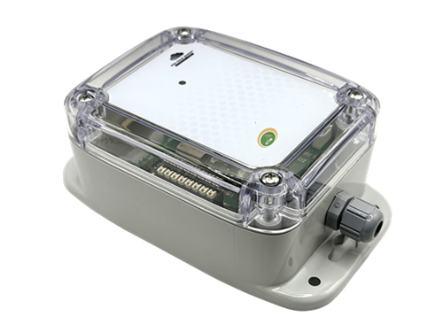

# ACW-MT1 – Entrée TOR ou comptage



Module à une entrée : détection de changement d’état (TOR) ou comptage d’impulsions, avec un accéléromètre qui signale un déplacement du produit. Disponible en LoRaWAN, Sigfox, LTE-M et NB-IoT.

Ce codec concerne le MT1 qui s’annonce avec le type produit 0x9F (ACW/MR1 dans le configurateur). Le MT1 de la gamme MIO (ACW/MIO-MT1) utilise le codec [ACW-MIO](../acw-mio). Les deux produits envoient les mêmes trames montantes, mais leurs paramètres de configuration ont des numéros différents : n’utilisez pas les commandes de l’un sur l’autre.

## Documentation

| Fiche technique | Guide utilisateur |
|---|---|
| [PDF](https://atim.com/wp-content/uploads/documentation/ACW/ACW-CEL-MT1/Francais/ATIM_ACW-MT1_DS_FR.pdf) | [PDF](https://atim.com/wp-content/uploads/documentation/ACW/ACW-CEL-MT1/Francais/ATIM_ACW-MT1_UG_FR.pdf) |

Le compteur est envoyé sur 4 octets (type de voie 0x04), comme sur la gamme MIO. Les exemples de trames du guide utilisateur v1.0 montrent un compteur sur 2 octets (type 0x03), ce qui ne correspond pas au firmware.

## Codec

| Fichier | Version | Points d’entrée |
|---|---|---|
| [acw-mt1-codec.js](acw-mt1-codec.js) | 1.0.0 | `decodeUplink`, `encodeDownlink`, `decodeDownlink` |

Le même fichier se colle tel quel dans The Things Stack (TTN v3), ChirpStack v4 et ChirpStack v3. Voir [intégration aux plateformes](../../docs/plateformes.md).

Version anglaise de ce codec (champs et libellés en anglais) : [../../../en/io-modules/acw-mt1](../../../en/io-modules/acw-mt1).

## Champs remontés

Une mesure est un nombre, ou un tableau (échantillon le plus récent en premier) quand la trame contient un historique. Voir [format de sortie](../../docs/format-de-sortie.md).

| Champ | Description | Type | Unité |
|---|---|---|---|
| `compteur0` | Index du compteur de l’entrée | nombre |  |
| `input_state0` | État de l’entrée : 1/0 dans les trames périodiques ; `"mise à l'état haut"`, `"mise à l'état bas"`, `"état haut"` ou `"état bas"` dans les trames de changement d’état | nombre |  |
| `periode` | Période d’émission | nombre | minute |
| `voltagec` | Tension en charge (pendant l’émission) | nombre | V |
| `voltagev` | Tension à vide | nombre | V |
| `frame_type` | Type de trame | texte |  |
| `erreur` | Erreur ou alarme, par exemple « Détection d’un déplacement/vol sur le produit » (accéléromètre) | texte |  |
| `horodatage` | Horodatage de la trame (ISO 8601 UTC) | texte |  |

En LTE-M et NB-IoT, la trame de mesure étendue ajoute `index_trame`, et la trame de vie peut contenir la position GPS (`etat_gps`, `latitude`, `longitude`). Voir [format de sortie](../../docs/format-de-sortie.md#produits-en-lte-m--nb-iot).

### Réponses aux commandes

| Champ | Description | Type | Unité |
|---|---|---|---|
| `configuration_acceptee` | 1 si tous les paramètres ont été acceptés, 0 sinon | nombre |  |
| `parametres_refuses` | Position (à partir de 1) des paramètres refusés dans la trame envoyée | liste |  |
| `erreur_downlink` | Trame descendante refusée : cause | texte |  |
| `commande` | Numéro de la commande à laquelle le produit répond | nombre |  |
| `config_entree1` | Configuration relue de l’entrée, par exemple « Compteur, tirage haut, front montant » | texte |  |
| `periode_trame_vie` | Période de la trame de vie relue | texte |  |
| `horodatage_active` | Horodatage des trames montantes relu : 0 ou 1 | nombre |  |

## Commandes descendantes

Passez une ou plusieurs de ces clés dans `input.data` de `encodeDownlink`. Voir [commandes descendantes](../../docs/commandes-descendantes.md).

| Clé | Description | Type | Valeurs acceptées |
|---|---|---|---|
| `setKeepAlivePeriod` | Période de la trame de vie | texte | Disable / Désactivé, Once every hour / Toutes les heures, Once every day / Tous les jours… (voir [commandes descendantes](../../docs/commandes-descendantes.md)) |
| `setDataloggingPeriod` | Période d’émission en minutes | nombre | 1 – 65535 minutes |
| `setTimestamp` | Horodatage des trames montantes : 0 = désactivé, 1 = activé | nombre | 0 – 1 |
| `setInput1Config` | Rôle de l’entrée (paramètre 30, voir ci-dessous) | objet | `{ mode, pull, trigger }` ou l’octet de configuration |
| `setCounter1` | Force la valeur du compteur. À envoyer seule. | nombre | 0 – 4294967295 |
| `getConfiguration` | Relit la trame de vie, l’horodatage, l’enregistrement et l’entrée. À envoyer seule. | nombre | 1 |

### Configuration de l’entrée

| `mode` | Rôle | Autres clés |
|---|---|---|
| `"disabled"` | Entrée désactivée | |
| `"edge"` | Entrée TOR : une trame est envoyée à chaque front | `pull` : `"none"` (défaut), `"up"`, `"down"` ; `trigger` : `"rising"`, `"falling"`, `"both"` (défaut) |
| `"counter"` | Comptage d’impulsions | `pull`, `trigger` (défaut `"rising"`) |

Configuration usine : compteur, tirage haut, front montant (`1e52`).

## BACnet (passerelle MultiTech Conduit)

Pour exposer ce produit en BACnet sur une passerelle MultiTech Conduit (mPower, licence Payload Management), importez ces deux fichiers dans **Payload Management > Sensor Definitions > Import** :

| Fichier | Rôle |
|---|---|
| [acw-mt1-bacnet-definition.json](acw-mt1-bacnet-definition.json) | Définition : propriétés BACnet, types, unités, objets en écriture |
| [acw-mt1-bacnet-codec.js](acw-mt1-bacnet-codec.js) | Décodeur/encodeur : ce codec, avec une seule valeur par propriété |

Chaque champ remonté devient un objet BACnet en lecture. Une trame historisée donne l’échantillon le plus récent. Voir [BACnet](../../docs/bacnet.md).

En écriture : `setKeepAlivePeriod`, `setDataloggingPeriod`, `setTimestamp`, `setInput1Config` (octet de configuration), `setCounter1` et `getConfiguration`. L’objet texte `inputConfigHelp` rappelle le format de l’octet de configuration.

## Exemples

Tous les cas de test sont dans [examples.json](examples.json). Ils sont exécutés par `npm test`.

### Trames montantes

**Compteur de l’entrée** – payload `a00400000885`, fPort 1

```json
{
  "frame_type": "Trame de mesure",
  "compteur0": 2181
}
```

**Compteur historisé, 2 échantillons** – payload `a1003c04000008a400000885`, fPort 1

```json
{
  "frame_type": "Trame de mesure",
  "periode": 60,
  "compteur0": [
    2212,
    2181
  ]
}
```

**État de l’entrée et compteur** – payload `a001010400000885`, fPort 1

```json
{
  "frame_type": "Trame de mesure",
  "compteur0": 2181,
  "input_state0": 1
}
```

**Changement d’état de l’entrée** – payload `a00111`, fPort 1

```json
{
  "frame_type": "Trame de mesure",
  "input_state0": "mise à l'état haut"
}
```

**Trame de mesure étendue (LTE-M / NB-IoT)** – payload `8900000100010002003c040000003e0000003c`, fPort 1

```json
{
  "frame_type": "Trame de mesure étendue",
  "index_trame": 256,
  "periode": 60,
  "compteur0": [
    62,
    60
  ]
}
```

**Trame de vie** – payload `810d240c68`, fPort 1

```json
{
  "frame_type": "Trame de vie",
  "voltagec": 3.176,
  "voltagev": 3.364
}
```

**Trame de vie avec position GPS (LTE-M / NB-IoT)** – payload `810d240c6803293ee90513c6`, fPort 1

```json
{
  "frame_type": "Trame de vie",
  "voltagec": 3.176,
  "voltagev": 3.364,
  "etat_gps": "Position trouvée",
  "latitude": 45.05135,
  "longitude": 5.5457
}
```

**Déplacement détecté par l’accéléromètre** – payload `8e019e`, fPort 1

```json
{
  "frame_type": "Trame d'erreur",
  "erreur": "Détection d’un déplacement/vol sur le produit"
}
```

**Configuration acceptée** – payload `8600`, fPort 1

```json
{
  "frame_type": "Réponse à une trame de configuration",
  "configuration_acceptee": 1,
  "parametres_refuses": []
}
```

**Relecture de la configuration de l’entrée** – payload `87041e52`, fPort 1

```json
{
  "frame_type": "Réponse à une trame de commande",
  "commande": 4,
  "config_entree1": "Compteur, tirage haut, front montant"
}
```

**Erreur de commande : paramètre inconnu** – payload `8803`, fPort 1

```json
{
  "frame_type": "Réponse à une trame erronee",
  "erreur_downlink": "Paramètre inconnu"
}
```

### Trames descendantes

| Description | `input.data` | Octets (hex) | fPort |
|---|---|---|---|
| Trame de vie une fois par jour | `{"setKeepAlivePeriod":"Once every day"}` | `0306` | 1 |
| Période d'enregistrement à 300 minutes | `{"setDataloggingPeriod":300}` | `d403012c01` | 1 |
| Activer l'horodatage des trames montantes | `{"setTimestamp":1}` | `0b01` | 1 |
| Entrée en compteur, tirage haut, front montant (configuration usine) | `{"setInput1Config":{"mode":"counter","pull":"up","trigger":"rising"}}` | `1e52` | 1 |
| Entrée en TOR, tirage haut, fronts montant et descendant | `{"setInput1Config":{"mode":"edge","pull":"up","trigger":"both"}}` | `1ed1` | 1 |
| Entrée désactivée | `{"setInput1Config":{"mode":"disabled"}}` | `1e00` | 1 |
| Forcer le compteur à 1000 | `{"setCounter1":1000}` | `c1061101e8030000` | 1 |
| Relire la configuration | `{"getConfiguration":true}` | `c10504030b141e` | 1 |
| Trame de vie une fois par jour (valeur en français) | `{"setKeepAlivePeriod":"Tous les jours"}` | `0306` | 1 |
