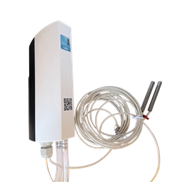

# ACW-PTMxP – Transmetteur de pression différentielle



Transmetteur de pression différentielle (±1250 Pa) avec zéro, une ou deux sondes PT1000 et une entrée configurable en report d’état ou en comptage (PTM0P, PTM1P, PTM2P).

## Modèles couverts

- ACW-PTMxP

## Documentation

| Modèle | Fiche technique | Guide utilisateur |
|---|---|---|
| ACW-PTMxP | [PDF](https://www.atim.com/wp-content/uploads/documentation/ACW/ACW-PTMxP/FRANCAIS/ATIM_ACW-PTMxP_DS_FR.pdf) | [PDF](https://www.atim.com/wp-content/uploads/documentation/ACW/ACW-PTMxP/FRANCAIS/ATIM_ACW-PTMxP_UG_FR.pdf) |

## Codec

| Fichier | Version | Points d’entrée |
|---|---|---|
| [acw-ptmxp-codec.js](acw-ptmxp-codec.js) | 1.0.0 | `decodeUplink`, `encodeDownlink`, `decodeDownlink` |

Le même fichier se colle tel quel dans The Things Stack (TTN v3), ChirpStack v4 et ChirpStack v3. Voir [intégration aux plateformes](../../docs/plateformes.md).

Version anglaise de ce codec (champs et libellés en anglais) : [../../../en/environment/acw-ptmxp](../../../en/environment/acw-ptmxp).

## Champs remontés

Une mesure est un nombre, ou un tableau (échantillon le plus récent en premier) quand la trame contient un historique. Voir [format de sortie](../../docs/format-de-sortie.md).

| Champ | Description | Type | Unité |
|---|---|---|---|
| `temperature0` | Température 1 (sonde 1) | nombre | Cel |
| `temperature1` | Température 2 (sonde 2) | nombre | Cel |
| `pression_differentielle` | Pression différentielle | nombre | Pa |
| `compteur0` | Compteur 1 (voie 0) | nombre |  |
| `input_state0` | Entrée 1 | nombre (0/1) |  |
| `periode` | Période d’enregistrement | nombre | minute |
| `voltagec` | Tension en charge (pendant l’émission) | nombre | V |
| `voltagev` | Tension à vide | nombre | V |
| `frame_type` | Type de trame | texte |  |
| `alerte` | Alerte | texte |  |
| `erreur` | Erreur | texte |  |
| `horodatage` | Horodatage de la trame (ISO 8601 UTC) | texte |  |

## Commandes descendantes

Passez une ou plusieurs de ces clés dans `input.data` de `encodeDownlink`. Voir [commandes descendantes](../../docs/commandes-descendantes.md).

| Clé | Description | Type | Valeurs acceptées |
|---|---|---|---|
| `setKeepAlivePeriod` | Période de la trame de vie | texte | Disable / Désactivé, Once every 10 mins / Toutes les 10 minutes, Once every hour / Toutes les heures, Once every 2 hours / Toutes les 2 heures, Once every 4 hours / Toutes les 4 heures, Once every 8 hours / Toutes les 8 heures, Once every day / Tous les jours, Once every 2 days / Tous les 2 jours, Once every 3 days / Tous les 3 jours, Once every 4 days / Tous les 4 jours, Once every week / Toutes les semaines, Once every month (30 days) / Tous les mois (30 jours) |
| `setDataloggingPeriod` | Période d’enregistrement en minutes | nombre | 1 – 65535 minutes |
| `setTimestamp` | Horodatage des trames montantes : 0 = désactivé, 1 = activé | nombre | 0 – 1 |

## BACnet (passerelle MultiTech Conduit)

Pour exposer ce produit en BACnet sur une passerelle MultiTech Conduit (mPower, licence Payload Management), importez ces deux fichiers dans **Payload Management > Sensor Definitions > Import** :

| Fichier | Rôle |
|---|---|
| [acw-ptmxp-bacnet-definition.json](acw-ptmxp-bacnet-definition.json) | Définition : propriétés BACnet, types, unités, objets en écriture |
| [acw-ptmxp-bacnet-codec.js](acw-ptmxp-bacnet-codec.js) | Décodeur/encodeur : ce codec, avec une seule valeur par propriété |

Chaque champ remonté devient un objet BACnet en lecture. Une trame historisée donne l’échantillon le plus récent. Voir [BACnet](../../docs/bacnet.md).

## Exemples

Tous les cas de test sont dans [examples.json](examples.json). Ils sont exécutés par `npm test`.

### Trames montantes

**Deux températures et pression différentielle** – payload `a008088518085006fd24`, fPort 1

```json
{
  "frame_type": "Trame de mesure",
  "temperature0": 21.81,
  "temperature1": 21.28,
  "pression_differentielle": -732
}
```

**Compteur et deux températures** – payload `a00400000014080885180823`, fPort 1

```json
{
  "frame_type": "Trame de mesure",
  "temperature0": 21.81,
  "temperature1": 20.83,
  "compteur0": 20
}
```

**Températures historisées** – payload `a1003c08088508a418082308c8`, fPort 1

```json
{
  "frame_type": "Trame de mesure",
  "periode": 60,
  "temperature0": [
    21.81,
    22.12
  ],
  "temperature1": [
    20.83,
    22.48
  ]
}
```

**Trame de vie** – payload `810e100dac`, fPort 1

```json
{
  "frame_type": "Trame de vie",
  "voltagec": 3.5,
  "voltagev": 3.6
}
```

**Changement d'état des entrées** – payload `a00110`, fPort 1

```json
{
  "frame_type": "Trame de mesure",
  "input_state0": "mise à l'état bas"
}
```

### Trames descendantes

| Description | `input.data` | Octets (hex) | fPort |
|---|---|---|---|
| Trame de vie une fois par jour | `{"setKeepAlivePeriod":"Once every day"}` | `0306` | 1 |
| Période d'enregistrement à 300 minutes | `{"setDataloggingPeriod":300}` | `d403012c01` | 1 |
| Activer l'horodatage des trames montantes | `{"setTimestamp":1}` | `0b01` | 1 |
| Trame de vie une fois par jour (valeur en français) | `{"setKeepAlivePeriod":"Tous les jours"}` | `0306` | 1 |
